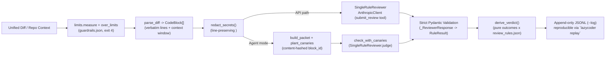

# Architecture

lazycoder separates **deterministic policy and contract enforcement** from **non-deterministic LLM judgement**. Everything that affects line anchoring, secret redaction, scope budgets, severity assignment, and verdict derivation runs as pure, unit-tested Python before or after the model call.

## 1. Deterministic Harness vs. LLM Reviewer Split

- **What the model decides (`_ReviewerResponse` / `SUBMIT_REVIEW_TOOL`)**: Only `outcome` (`pass` | `fail` | `insufficient_context`), `line`, `end_line`, and `reason`.
- **Forced structured tool call**: `AnthropicClient.generate` (`src/lazycoder/llm/anthropic_client.py`) sends `tools=[SUBMIT_REVIEW_TOOL]` with `strict: true` and `tool_choice={"type": "tool", "name": "submit_review"}`. If the response is truncated without a tool block, raw text falls back to `SingleRuleReviewer._extract_json_object` (code-fence stripping + balanced-brace scan).
- **What the harness owns**: `file`, `rule_id`, and `severity` (`severity_if_unjustified` from `config/review_rules.json`) are never accepted from model output. Citations are validated against `block.covers(line)` (`start_line <= line <= end_line`). Any missing, duplicate, unparseable, or out-of-hunk response becomes a `RuleEvaluationError`.
- **Pure verdict policy (`derive_verdict`)**: `src/lazycoder/domain/aggregator.py` derives `BLOCK` if any `RuleOutcome.FAIL` has `Severity.HIGH`; `REQUEST_CHANGES` if any rule failed, any `RuleEvaluationError` occurred (including missed canaries), or any `Severity.HIGH` rule returned `insufficient_context`; otherwise `APPROVE`. Domain invariants in `ReviewReport` (`src/lazycoder/domain/models.py`) make mismatched findings or verdicts unrepresentable.

## 2. Pre-LLM Line-Preserving Redaction & Prompt Isolation

- **`redact_secrets` (`src/lazycoder/redact.py`)**: Runs at both exits (`SingleRuleReviewer.build_prompt` and `agent_mode.build_packet`) without modifying the underlying `CodeBlock` used for citation validation. Known credential prefixes (`sk-`, `gh*_`, `github_pat_`, `AKIA`, `xox*-`, `AIza`), `-----BEGIN ... PRIVATE KEY-----` bodies, and 8+ character literals assigned to secret-named keys are replaced on the **same line** with `<redacted:secret>`. Line numbers never shift, and R7 can still flag hardcoded credentials without seeing secret material.
- **Untrusted-data framing**: Code blocks are line-numbered by the harness (`N\t<code>`, or `N*\t<code>` for hunk lines inside a `--context` ±120-line window), fenced between `----- BEGIN UNTRUSTED CODE BLOCK -----` / `END` markers, and explicitly declared data rather than instructions.

## 3. Content-Hashed `block_id`, Seeded Canaries & JSONL `replay`

- **`block_id` (`src/lazycoder/agent_mode.py`)**: First 12 hex characters of `SHA-256(file \0 start_line \0 code [\0 context_start \0 context])`. Answers produced for a different diff, hunk, or context setting are rejected with exit `3`.
- **Seeded canary planting (`plant_canaries` / `check_with_canaries`)**: Using `canary_seed(diff_text, preset)` (`SHA-256(preset \0 diff_text)`), both `packet` and `check` deterministically sample and insert known-defect snippets from `fixtures/deny/` under plausible filenames without passing hidden state through the agent. Canary findings are stripped from the final `ReviewReport`, while a missed canary injects a `RuleEvaluationError` (blocking `APPROVE`) and logs `canaries: {planted, caught}`.
- **Append-only decision log & `replay` (`src/lazycoder/decision_log.py`)**: `--log PATH` appends one JSONL record per run (`run_id`, `engine_version`, `model`, `rubric_sha256`, `diff_sha256`, timestamps, `preset`, `canaries`, `verdict`, full `report`). `lazycoder replay LOG` recomputes `derive_verdict` from `rule_results` and `rule_errors` without constructing any LLM client, exiting `1` if any record drifts.

## 4. Guardrails, Error Handling, Timeouts/Retries & Idempotency

- **Scope guardrails (`config/guardrails.json`, `src/lazycoder/limits.py`)**: Before any `AnthropicClient` is constructed, `measure()` computes file count (`max_files_per_run = 50` across all modes) and estimated API input tokens (`max_tokens_budget = 200,000` at 4 chars/token plus `SYSTEM_PROMPT` + `SUBMIT_REVIEW_TOOL` overhead). Exceeding either exits `4` (`EXIT_SCOPE`) with zero API spend unless `--allow-large` is passed.
- **Timeouts, retries & soft-skip (`AnthropicClient`, `action.yml`, `scripts/soft_skip.py`)**: `AnthropicClient` delegates HTTP transport timeouts and bounded retries to the official `anthropic` SDK (`Anthropic()`). Per-rule malformed responses (`LLMReviewerParseError`) are isolated to `RuleEvaluationError`; `anthropic.APIError` aborts the review (`EXIT_ERROR = 3`). In `action.yml`, when `fail-on: never` (default), exit `4` or auth/billing/rate-limit/overloaded errors matched by `scripts/soft_skip.py` soft-skip as `verdict=SKIPPED` before any sticky PR comment is written.
- **Idempotency**: Pure harness stages (`parse_diff`, `redact_secrets`, `block_id`, `canary_seed`, `derive_verdict`, `replay_verdict`) are deterministic functions of their inputs. Sticky PR comments (`scripts/render_comment.py`) carry `<!-- lazycoder-report -->` so `action.yml` patches the existing comment instead of creating duplicates. `lazycoder init` refuses to overwrite an existing skill without `--force`.

## 5. Why `fail-on: never` Stays the Default

Committed evaluations show why advisory mode remains mandatory until Stage 3a file-level context and rule calibration land:
- **Stage 1 (`fixtures/`, `claude-opus-5`)**: `0/13` cases passed — recall `0.92` (`11/12`), precision `0.17` (`11` true, `53` false), with R3/R4/R12 firing spuriously on clean/other-defect code.
- **Stage 2 (`corpus/seed.jsonl`, 37 OSS hunks, agent mode)**: `86%–100%` clean quiet rate, but hunk recall `1/15` → `3/15` → `5/15` (even with `--context` ±120 lines), failing the pre-registered `fail_on_gate` (`quiet_rate >= 80%`, `hunk_recall >= 50%`, no `high` rule `> 5%` clean noise).

Until a larger corpus calibration run satisfies `fail_on_gate`, `action.yml` defaults to `fail-on: never`.
